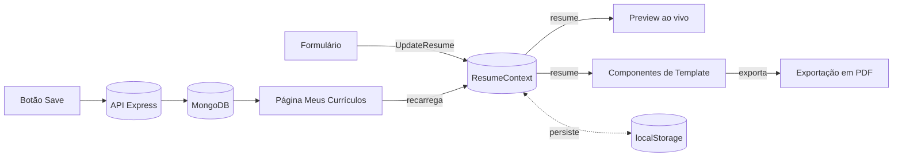

# Sheetsty

**Monte, personalize e exporte um currículo profissional em minutos — sem precisar de habilidade com design.**

Sheetsty é um construtor de currículos full-stack. Preencha um formulário, veja cinco layouts diferentes se atualizarem em tempo real enquanto você digita, ajuste a fonte e a cor de destaque, e exporte um PDF pronto pra impressão e fiel ao que aparece na tela — tudo no navegador, com salvamento em nuvem opcional para usuários cadastrados.

[](https://nextjs.org/)
[](https://react.dev/)
[](https://www.typescriptlang.org/)
[](https://tailwindcss.com/)
[](https://www.mongodb.com/)

---

## Sumário

- [Funcionalidades](#funcionalidades)
- [Como Funciona](#como-funciona)
- [Stack Utilizada](#stack-utilizada)
- [Estrutura do Projeto](#estrutura-do-projeto)
- [Como Rodar o Projeto](#como-rodar-o-projeto)
- [Variáveis de Ambiente](#variáveis-de-ambiente)
- [Scripts Disponíveis](#scripts-disponíveis)
- [Roadmap e Limitações Conhecidas](#roadmap-e-limitações-conhecidas)

## Funcionalidades

- **Editor em tempo real** — cada campo do formulário atualiza a pré-visualização instantaneamente, sem precisar salvar para ver o resultado.
- **Cinco layouts, uma única fonte de dados** — One Column, Two Columns, Minimal, Header Band e Sidebar Right renderizam a partir dos mesmos dados, então trocar de modelo nunca perde informação.
- **Seções dinâmicas** — adicione ou remova quantas experiências profissionais e projetos forem necessários; o layout se ajusta automaticamente.
- **Personalização visual** — cor de destaque, família e tamanho de fonte, aplicados de forma consistente no editor e em todos os modelos.
- **Exportação em PDF fiel à tela** — o arquivo exportado é dimensionado pra bater exatamente com o card exibido na tela, sem corte nem espaço em branco sobrando.
- **Salvamento automático** — o currículo atual persiste no `localStorage`, então um refresh nunca derruba o progresso.
- **Salvamento em nuvem e biblioteca de currículos** — usuários cadastrados podem salvar um currículo no banco de dados e recarregá-lo depois na página *Meus Currículos*.
- **Totalmente responsivo** — o layout de duas colunas (editor/preview) vira uma única coluna rolável no mobile.

## Como Funciona

O editor e cada modelo de preview são componentes independentes que leem de um único `ResumeContext`. Digitar no formulário atualiza um único estado; todo consumidor — a pré-visualização ao vivo, o modelo ativo, o exportador de PDF — renderiza a partir dessa mesma fonte, então nunca existe uma etapa de sincronização entre "o que eu digitei" e "o que eu vejo".



Exportar para PDF captura o mesmo elemento do DOM que está sendo exibido na tela — não um template de impressão separado — e é isso que mantém o arquivo baixado visualmente idêntico à pré-visualização.

## Stack Utilizada

**Frontend**
- [Next.js 15](https://nextjs.org/) (App Router) + [React 19](https://react.dev/) + [TypeScript](https://www.typescriptlang.org/)
- [Tailwind CSS 4](https://tailwindcss.com/) para layout e estilização utilitária
- [Framer Motion](https://www.framer.com/motion/) para as animações de transição entre templates
- [react-to-pdf](https://github.com/ivmarcos/react-to-pdf) para geração de PDF no navegador
- [react-color](https://casesandberg.github.io/react-color/) para o seletor de cor de destaque
- Uma pequena biblioteca interna de componentes (`@av-digital/components`) com as peças compartilhadas (`Flex`, `Stack`, `Card`, `Text`, `Button`)

**Backend**
- [Node.js](https://nodejs.org/) + [Express](https://expressjs.com/)
- [MongoDB](https://www.mongodb.com/) via [Mongoose](https://mongoosejs.com/)
- [Passport.js](https://www.passportjs.org/) (estratégia local) com autenticação baseada em sessão
- [bcryptjs](https://github.com/dcodeIO/bcrypt.js) para hash de senha

## Estrutura do Projeto

```
.
├── index.js                     # Ponto de entrada da API Express (auth, persistência de currículos)
├── curriculum.js                # Schema Mongoose dos currículos salvos
├── register.js                  # Schema Mongoose das contas de usuário
└── src/
    ├── app/
    │   ├── hooks/
    │   │   └── useResumeContext.tsx   # Fonte única de verdade dos dados do currículo
    │   ├── login/, register/          # Páginas de autenticação
    │   └── curriculums/                # Biblioteca de currículos salvos
    ├── resume/
    │   ├── page.tsx                   # O formulário editável do currículo
    │   └── preview/
    │       ├── preview.tsx            # Preview ao vivo, troca de template, exportação em PDF
    │       └── objects/                # Definições dos campos do formulário
    └── components/
        └── Templates/
            ├── TemplateMain/           # One Column
            ├── TemplateColum/          # Two Columns
            ├── TemplateMinimal/
            ├── TemplateHeaderBand/
            ├── TemplateSidebarRight/
            └── shared.tsx              # Peças compartilhadas entre todos os templates
```

## Como Rodar o Projeto

### Pré-requisitos

- [Node.js](https://nodejs.org/) 18 ou superior
- [MongoDB](https://www.mongodb.com/) (instância local ou um cluster gratuito no [Atlas](https://www.mongodb.com/atlas)) — necessário só para os recursos de salvamento/autenticação; o construtor de currículo em si funciona totalmente offline via `localStorage`

### Instalação

```bash
git clone https://github.com/Viniciuzjp/CV_Maker.git sheetsty
cd sheetsty
npm install
```

Crie um arquivo `.env` na raiz do projeto (veja [Variáveis de Ambiente](#variáveis-de-ambiente)).

### Rodando localmente

O frontend e a API rodam como dois processos separados:

```bash
# Terminal 1 — frontend (http://localhost:3000)
npm run dev

# Terminal 2 — API (http://localhost:3001)
node index.js
```

O construtor de currículo funciona imediatamente sem a API rodando; só o Save, Login, Register e a página Meus Currículos dependem dela.

## Variáveis de Ambiente

| Variável | Usada por | Descrição | Padrão |
| --- | --- | --- | --- |
| `NEXT_PUBLIC_API_URL` | Frontend | URL base da API Express | `http://localhost:3001` |
| `MONGODB_URI` | API | String de conexão do MongoDB | `mongodb://127.0.0.1:27017/CvMaker` |
| `SESSION_SECRET` | API | Segredo usado pra assinar os cookies de sessão | — |
| `CLIENT_ORIGIN` | API | Origem permitida pelo CORS (a URL do frontend) | `http://localhost:3000` |
| `OPENAI_API_KEY` | API | Reservada para uma futura funcionalidade de assistência de escrita com IA | — |

## Scripts Disponíveis

| Comando | Descrição |
| --- | --- |
| `npm run dev` | Inicia o servidor de desenvolvimento do Next.js |
| `npm run build` | Cria um build de produção otimizado |
| `npm run start` | Serve o build de produção |
| `npm run lint` | Roda o ESLint |

## Roadmap e Limitações Conhecidas

- Rotas como `/curriculums` ainda não ficam atrás de autenticação.
- O backend precisa ser implantado e conectado a uma instância gerenciada do MongoDB separadamente do frontend; `node index.js` ainda não tem um script `npm` dedicado.
- A integração com `OPENAI_API_KEY` já está ligada no backend (`/chat`), mas ainda não foi exposta na interface.
- A exportação hoje suporta uma única página; currículos muito longos ainda não são paginados em múltiplas páginas de PDF.

## Licença

Distribuído sob a Licença MIT. Veja [`LICENSE`](./LICENSE) para mais detalhes.
